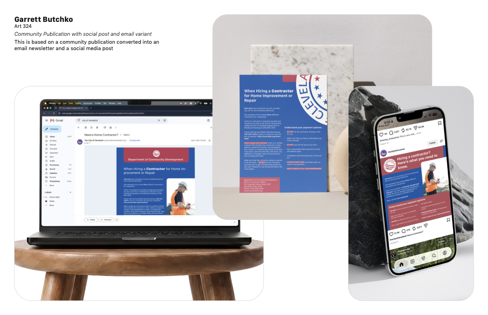
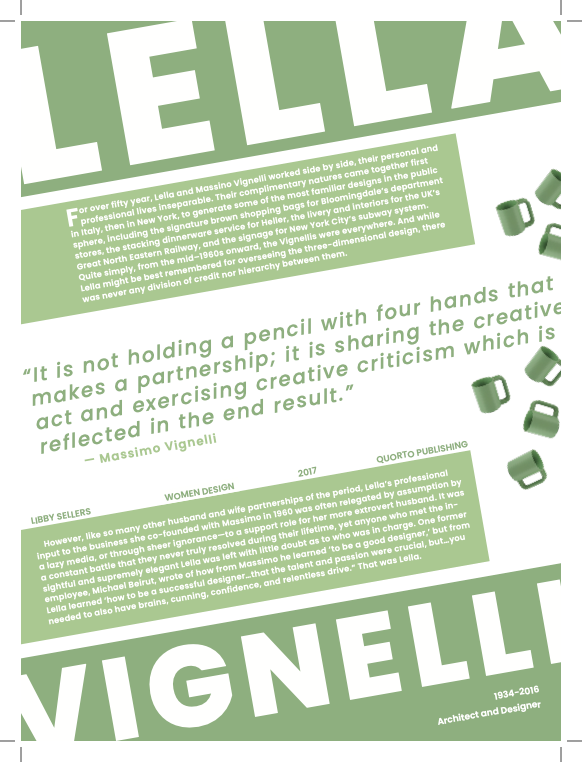
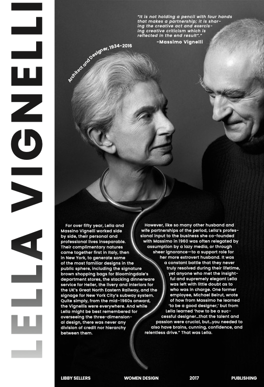

# Design Portfolio

A curated collection of design works, editorial layouts, promotional posters, and digital portfolio projects developed both for academic coursework and independent creative work outside of class.

---

## 🎨 Featured Projects

### 1. Portfolio Website & Digital Showcase
*Personal / Independent Project (Outside of Class)*

A showcase highlighting digital design identity, project galleries, and responsive web presentation.

  

- **File**: `Screenshot 2026-11-19 at 5.43.47 PM.png`
- **Focus**: Web UI layout, portfolio curation, visual presentation.

---

### 2. Community Publication & Social/Email Campaign
*Coursework Project (Art 324)*

An editorial and multichannel marketing design based on a community publication converted into an email newsletter variant and social media campaign assets.

  

- **Document**: [`Butchko_342_P1_Poster.pdf`](./Butchko_342_P1_Poster.pdf)
- **Course**: Art 324
- **Focus**: Editorial design, multi-platform adaptation (print publication, social media post, email newsletter).

---

### 3. Editorial & Typographic Study: Lella & Massimo Vignelli
*Coursework / Design Study (Project 1)*

An exploration of grid systems, high-contrast modernist typography, and biographical narrative focused on influential designers Lella and Massimo Vignelli.

  
  &nbsp;&nbsp;&nbsp;&nbsp;
  

- **Documents**: 
  - [`Project_1_(7.5x10).pdf`](./Project_1_(7.5x10).pdf) (7.5 × 10 editorial format)
  - [`Project 1 (dragged) 3.pdf`](./Project%201%20%28dragged%29%203.pdf) (Spread layout & typographic iteration)
- **Focus**: Modular grid hierarchy, typography (Poppins typeface suite), biographical editorial design.

---

## 📂 Project Overview

| Project | Category | Key Media / Deliverable |
| :--- | :--- | :--- |
| **Portfolio Site** | Outside of Class (Personal) | PNG Screenshot (`Screenshot 2026-11-19 at 5.43.47 PM.png`) |
| **Community Publication Campaign** | Class Project (Art 324) | PDF Poster Presentation (`Butchko_342_P1_Poster.pdf`) |
| **Vignelli Editorial & Typography Studies** | Class Project | PDF Layouts (`Project_1_(7.5x10).pdf`, `Project 1 (dragged) 3.pdf`) |

---

## 🛠 Tools & Techniques
- **Typography & Layout**: Modular grids, typographic hierarchy, multi-channel editorial adaptations.
- **Formats**: Digital web layouts, high-resolution print PDF spreads, email and social media deliverables.
